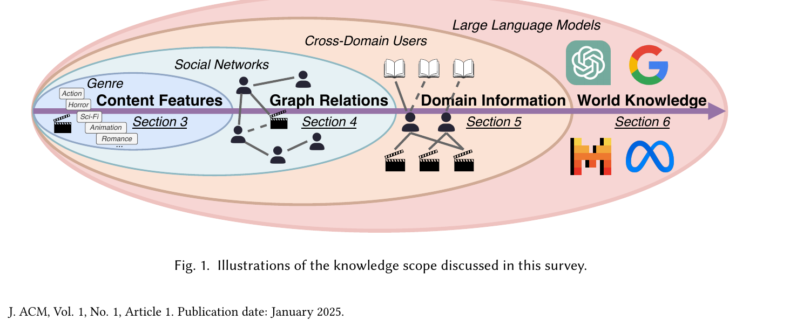
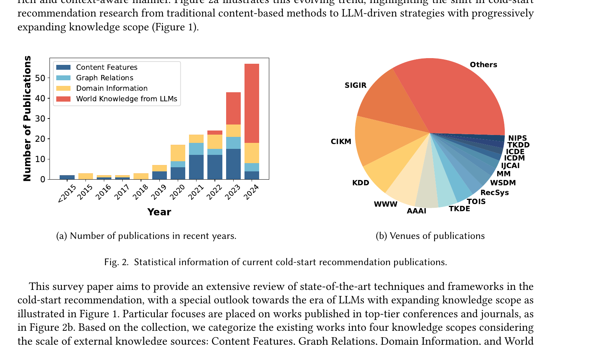
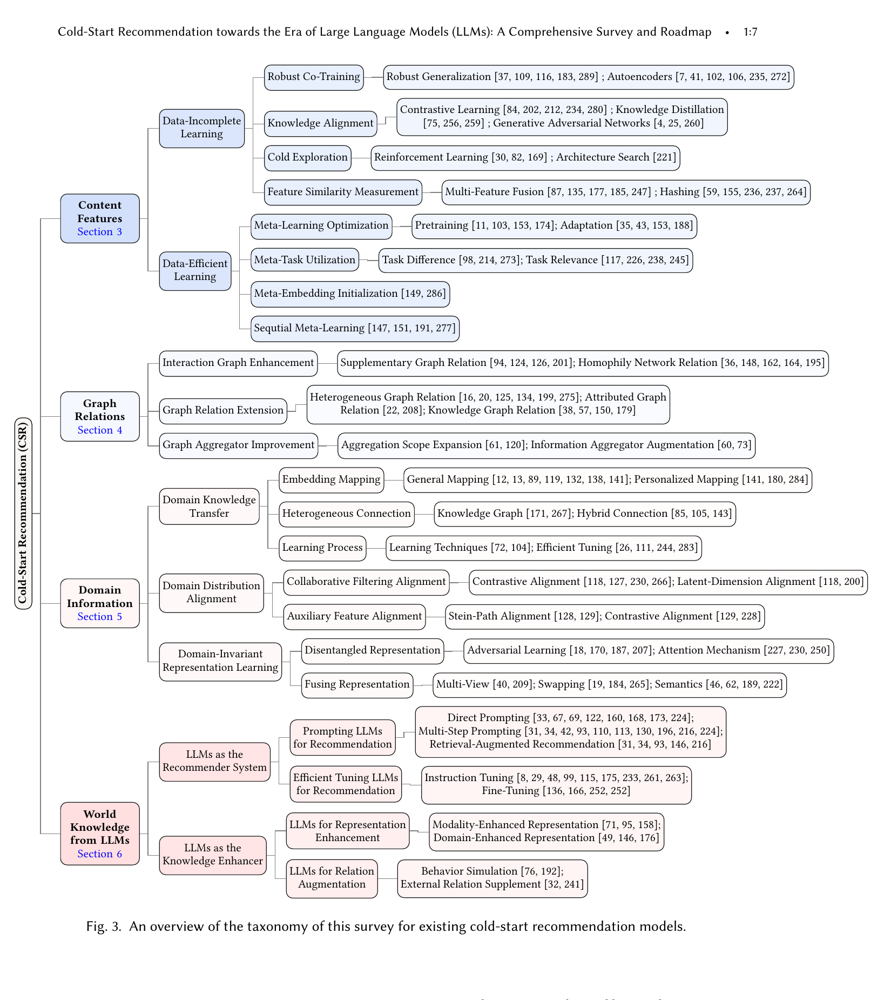

> 一句话摘要：冷启动推荐的关键不是“把一个新用户硬塞进旧模型”，而是明确可用的知识来源、迁移假设与评估协议，再选择内容、图关系、跨域信息或 LLM 世界知识来补足缺失的交互历史。

## 一、论文概览

这是一篇**综述与路线图（survey and roadmap）**，系统梳理冷启动推荐（Cold-Start Recommendation, CSR）的任务定义、方法谱系、公开数据与评估方式，并讨论大语言模型（LLM）带来的新知识来源。作者整理了截至 2024 年 12 月约 220 篇相关工作，将方法归纳到四种知识范围：

1. **Content Features**：文本、图像、类别、属性等内容特征。
2. **Graph Relations**：用户—物品交互图、相似关系、异构图和知识图谱。
3. **Domain Information**：跨领域知识、领域分布和领域不变表示。
4. **World Knowledge from LLMs**：由 LLM 提供的常识、语义表示、行为模拟和外部关系。

论文的核心问题是：当历史交互缺失时，模型究竟从哪里获得可迁移的信息？不同冷启动设置下，哪些假设是成立的？怎样让方法、数据划分与指标真正对应任务难度？

- 原文版本：arXiv v2，2025-01-16。
- 论文类型：领域综述、分类体系与研究路线图。
- 主要贡献：统一术语；给出按知识来源组织的分类；总结四类知识的代表方法；讨论 LLM 在推荐器与知识增强器两种角色中的用法；指出评估协议和可复现性问题。
- 阅读范围：本文把综述中的方法脉络翻译为课程和研究中便于复习的结构，个人迁移部分单独标注，不把它当成原论文的实验结论。

## 二、Motivation：为什么冷启动难

推荐系统通常依赖用户与物品之间的大量历史交互学习偏好。新用户、新物品或新域没有足够的点击、评分、购买和浏览记录，因此传统协同过滤的统计信号变弱，模型容易产生：

- 对新用户推荐热门但缺乏个性化的内容；
- 对新物品曝光不足，形成“越冷越没有数据”的反馈循环；
- 在跨域或系统迁移时，把源域的偏好错误地套用到目标域；
- 让离线指标的提升只反映数据泄漏、划分差异或额外特征，而不是更好的冷启动能力。

可以把冷启动抽象为：给定一个交互历史不完整的用户—物品集合，利用可获得的内容、关系、领域信息或外部世界知识，估计用户对候选物品的偏好排序。

### 2.1 常见冷启动类型

| 类型 | 含义 | 评估时要注意 |
| --- | --- | --- |
| **Long-tail** | 有交互，但交互数量很少，样本位于长尾。 | 需要报告交互数量分桶，不能和完全新样本混在一起。 |
| **Normal Cold Start** | 新用户或新物品只有少量交互。 | 明确“少量”是多少，以及这些交互是否参与训练。 |
| **Strict Cold Start** | 新用户或新物品没有任何历史交互。 | 只能使用内容、关系、跨域信息或外部知识。 |
| **Zero-shot** | 没有目标域协同过滤数据，但可以利用已有知识或预训练模型。 | 说明预训练数据与目标测试集是否存在重叠。 |
| **Few-shot** | 只有少量新数据用于适配。 | 报告每个用户/物品的支持集大小和采样方式。 |
| **User-item cold start** | 用户侧和物品侧同时冷启动。 | 比单侧冷启动更难，负样本与候选池要单独说明。 |
| **System cold start** | 新平台或新场景整体缺乏交互数据。 | 需要同时讨论系统先验、内容覆盖和探索策略。 |

这些名称在不同论文中并不总是一致。复现实验时，必须把训练、支持集、验证集、测试集和外部信息的边界写清楚；否则“同一个 cold start”可能对应完全不同的任务难度。

## Method：四类知识范围与方法谱系

## 三、四类知识范围：从可观察特征到世界知识

*图 1：论文原 Figure 1 的裁剪版。图中从内容特征与社交/交互关系，延伸到跨域信息和 LLM 提供的世界知识。*

这四类知识不是互斥的模型模块，而是回答“冷启动信号从哪里来”的四个视角。一个实际系统可以同时使用物品文本、用户社交图、源域行为和 LLM 生成的语义表示。

## 四、Content Features：利用内容特征补足协同信号

内容特征包括标题、描述、类别、标签、图像、音频和结构化属性。它们通常在新物品没有交互时仍然可用。

### 4.1 Data-Incomplete Learning

当内容或行为数据本身不完整时，研究通常围绕四个方向展开：

- **Robust Co-Training**：让多个视图互相补充，降低单一特征缺失造成的偏差。
- **Knowledge Alignment**：把不同来源的表示对齐，例如对比学习、知识蒸馏和生成式对抗网络。
- **Cold Exploration**：把强化学习或架构搜索用于主动探索，决定先收集哪些信息。
- **Feature Similarity Measurement**：通过多特征融合或哈希方法寻找与新样本相近的已知样本。

这些方法的共同点是承认数据缺失本身是问题，而不是假设内容特征永远干净、完整且语义一致。

### 4.2 Data-Efficient Learning

当目标域只有少量样本时，方法会尽量提高每个样本的利用效率：

- **Meta-Learning Optimization**：通过预训练和快速适配，学习“如何学习”新任务。
- **Meta-Task Utilization**：按任务差异或任务相关性选择更有帮助的元任务。
- **Meta-Embedding Initialization**：为新用户或新物品构造更好的初始嵌入。
- **Sequential Meta-Learning**：按顺序利用多个相关任务，减少从零开始的适配成本。

这类方法的风险是元任务与目标任务不匹配。若源任务看似相近、实际偏好机制不同，初始化可能带来负迁移。

## 五、Graph Relations：用关系结构放大少量交互

交互图提供了内容特征之外的结构信号。即使新节点只有很少的边，也可能通过邻居、社交关系或知识图谱获得信息。

### 5.1 Interaction Graph Enhancement

常见做法是补充交互图：

- 加入**补充图关系**，例如浏览、收藏、共现或社交关系；
- 利用**同质性网络关系**，让相似用户或相似物品共享统计强度。

关键问题是补边是否真实可获得。如果补充关系来自测试期或未来日志，就会造成时间泄漏。

### 5.2 Graph Relation Extension

关系扩展包括：

- **异构图关系**：把用户、物品、类别、作者、标签等节点放在同一张图中；
- **属性图关系**：显式使用节点属性和边属性；
- **知识图谱关系**：引入实体与关系的多跳信息。

关系越丰富，模型越可能找到冷启动线索，但噪声、图规模和推理成本也会同时增长。

### 5.3 Graph Aggregator Improvement

图聚合器的改进主要有：

- 扩大聚合范围，让新节点看到更远的结构上下文；
- 增强信息聚合，把多种关系或边权合并到节点表示中。

实践中要同时检查过平滑、邻居噪声和推理时延。冷启动系统常常更需要“可靠的少量邻居”，而不是无边界地扩大感受野。

## 六、Domain Information：从相关领域迁移知识

当目标域交互很少时，源域可以提供用户偏好、物品语义或行为模式，但迁移必须处理表示空间和分布差异。

### 6.1 Domain Knowledge Transfer

论文将这类工作分成三组：

- **Embedding Mapping**：通用映射或个性化映射，把源域和目标域嵌入对齐。
- **Heterogeneous Connection**：通过知识图谱或混合连接，让不同域共享可解释的中间关系。
- **Learning Process**：设计更高效的学习与适配过程，包括专门的迁移技巧和参数高效调优。

### 6.2 Domain Distribution Alignment

分布对齐常见两种路线：

- **Collaborative Filtering Alignment**：对齐协同过滤信号和潜在维度；
- **Auxiliary Feature Alignment**：对齐辅助特征，例如 Stein-path 或对比式对齐。

对齐的目标不是让两个域完全相同，而是提取可迁移的部分，同时保留目标域自己的偏好差异。

### 6.3 Domain-Invariant Representation Learning

领域不变表示通常包括：

- **Disentangled Representation**：解耦领域相关因素与领域不变因素，常结合对抗学习或注意力机制；
- **Fusing Representation**：融合多视图信息或交换不同来源的表示。

这类方法的难点在于“真正不变”的因素通常不可直接观测。过度去除域信息，可能把目标域中有用的个性化线索一起抹掉。

## 七、World Knowledge from LLMs：把 LLM 放在推荐器前后

LLM 带来的变化不是简单地把传统推荐模型替换成一个聊天模型，而是增加了新的知识入口。

### 7.1 LLM as a Recommender System

直接让 LLM 参与推荐，常见路线包括：

- **Direct Prompting**：把用户历史、物品描述和候选集组织成提示词；
- **Multi-Step Prompting**：把召回、解释、排序等步骤拆开；
- **Retrieval-Augmented Recommendation**：先检索相关内容，再让 LLM 结合上下文推荐；
- **Efficient Tuning**：通过指令调优或参数高效微调适配特定推荐任务。

优点是能利用语言、常识和解释能力；问题是候选集规模、输出稳定性、成本和可控性仍然是工程瓶颈。

### 7.2 LLM as a Knowledge Enhancer

LLM 也可以作为传统推荐器的知识增强模块：

- **Modality-Enhanced Representation**：用文本或多模态能力增强用户/物品表示；
- **Domain-Enhanced Representation**：补充领域语义和跨域知识；
- **Behavior Simulation**：模拟可能的用户行为；
- **External Relation Supplement**：为图模型补充外部关系。

这一角色更容易和现有召回、图学习、排序系统结合。一个稳妥的做法是让 LLM 离线生成候选特征、关系或行为轨迹，再由轻量模型进行校验与排序；这样可以把生成成本和在线延迟隔离开。

## Evaluation：研究趋势与评估协议

## 八、研究趋势与评估：图表之外要看协议

*图 2：论文原 Figure 2 的裁剪版，展示该主题随年份增长的论文数量及发表场所分布。*

综述汇总了约 220 篇工作，检索范围覆盖 Google Scholar、Web of Science 等来源，并关注推荐系统、冷启动、元学习、图学习和 LLM 等关键词。图中的增长趋势说明冷启动从传统推荐问题扩展成了跨域、图表示和基础模型共同参与的研究方向。

阅读这类统计图时要注意：

1. 论文数量不是算法效果，不能据此断言 LLM 方法普遍优于传统方法。
2. 不同论文使用的数据集、冷启动划分、候选池和额外信息不同，横向比较必须谨慎。
3. 评价指标要结合任务选择，例如 Recall/NDCG 关注排序，覆盖率和新颖性关注曝光结构，校准和公平性关注系统偏差。
4. 严格冷启动应避免把测试期交互、未来元数据或未经说明的预训练语料泄漏到表示中。

## 九、Taxonomy：如何读懂论文的方法谱系

*图 3：论文原 Figure 3 的裁剪版。分类树以知识来源为根，再按学习机制和具体方法展开。*

可以按三步阅读这棵树：

1. **先找知识来源**：方法依赖内容、图关系、领域信息还是 LLM 世界知识？
2. **再找补足机制**：是在补数据、对齐表示、扩展图关系，还是用元学习和提示调优快速适配？
3. **最后看额外假设**：需要哪些辅助特征、源域、邻居、预训练模型或在线探索？

这种读法比只记住模型名称更适合复现和选型，因为它直接对应冷启动时“可获得什么信息”。

## 十、个人思考：面向算子优化的迁移思考

下面是基于综述方法的个人迁移分析，不是原论文的实验结论。

| 冷启动知识来源 | 可迁移到算子优化的信号 | 可能的实现 |
| --- | --- | --- |
| 内容特征 | 算子语义、输入输出形状、dtype、布局、API 约束、硬件目标 | 将算子描述和历史实现编码成可检索特征。 |
| 图关系 | 算子调用图、融合关系、共享缓冲区、依赖边、失败轨迹 | 用程序图或调度图寻找结构相近的优化案例。 |
| 领域信息 | CUDA/编译器/后端/框架差异，以及模型域之间的迁移经验 | 对齐不同后端的表示，保留目标硬件的特有约束。 |
| LLM 世界知识 | API 文档、专家技能、编译器报错解释、常见优化模式 | 用 LLM 生成候选策略和检索标签，再交给编译与基准测试验证。 |

一个较稳妥的流程是：

~~~text
新算子
  -> 提取语义、形状、布局、依赖和硬件特征
  -> 检索相似算子、历史技能、API 文档与失败轨迹
  -> 按目标后端和历史收益重排候选策略
  -> 低成本探索少量候选
  -> 编译、正确性检查与性能测量
  -> 将成功/失败轨迹写回知识库
~~~

这对应综述中的两阶段思路：先用可迁移知识发现候选，再用目标任务的反馈筛选。对算子优化而言，检索结果不能直接当作正确答案；必须经过编译、数值正确性和重复性能测量。

一个值得警惕的点是：对比学习和复杂多视图融合可能提高表示能力，却也可能增加实现和调参成本。若算子样本量不大，可以先用结构化特征、简单相似度和可解释的规则建立基线，再逐步加入更复杂的表示学习。

## 十一、局限与开放问题

- **分类边界会重叠**：同一方法可能同时使用内容、图关系和领域信息，按单一类别归档会丢失组合关系。
- **评估协议不统一**：不同论文对“新用户”“新物品”“少量交互”的定义不同，指标很难直接比较。
- **LLM 的成本与可控性**：推理费用、延迟、上下文长度、幻觉、偏见和隐私风险仍然限制在线部署。
- **外部知识可靠性**：知识图谱、网页和 LLM 生成关系可能过时或错误，需要时间切分、来源追踪和置信度控制。
- **缺少因果证据**：离线排序指标提升不一定意味着真实用户体验、长期留存或探索收益提升。
- **冷启动与在线探索耦合**：真正的系统冷启动往往需要主动收集反馈，单纯离线数据集无法完整模拟这一过程。

## 十二、结论

这篇综述把冷启动推荐从“缺少协同过滤数据”重新表述为“需要选择并对齐可迁移知识”。内容特征提供语义先验，图关系提供结构先验，领域信息提供迁移先验，LLM 则提供更广的语言与世界知识。方法选择的关键不在于模型名字是否新，而在于任务中确实能获得哪些信息、这些信息是否会泄漏，以及评估协议是否和部署场景一致。

对算子优化等系统问题，最值得借鉴的是“知识来源—候选生成—目标反馈”的闭环：用语义、图结构、领域经验和文档知识缩小搜索空间，再用编译、正确性和性能测量决定最终策略。

## 参考链接

- Zhang, W. et al. *Cold-Start Recommendation towards the Era of Large Language Models (LLMs): A Comprehensive Survey and Roadmap*. [arXiv:2501.01945](https://arxiv.org/abs/2501.01945)
- [论文 PDF](https://arxiv.org/pdf/2501.01945)
- [Awesome Cold-Start Recommendation](https://github.com/YuanchenBei/Awesome-Cold-Start-Recommendation)
