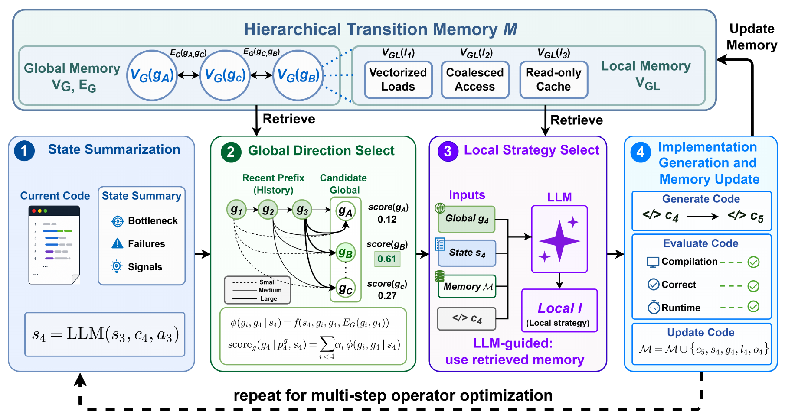
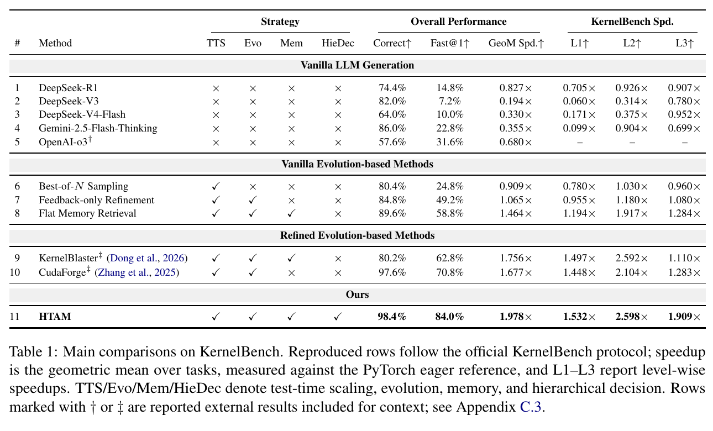
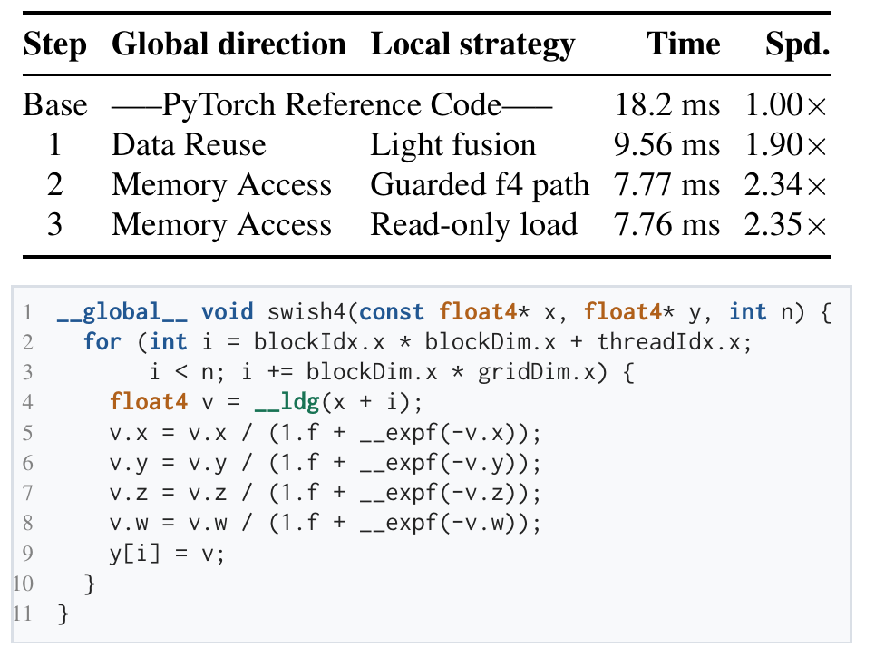

“优化访存”是一条正确但不太好执行的建议。面对一段具体 kernel，模型仍要决定：改成向量化加载，重新安排线程，还是减少重复读取？

把这些方法全部放进提示里，又会出现另一个问题。很多建议单独看都有道理，但它们不一定适合当前代码，也不一定适合当前优化阶段。刚完成算子融合，和刚完成向量化，下一步值得做的事情可能不同。

HTAM 尝试把这类经验分成三部分：全局方向回答先解决哪类问题，局部策略回答具体怎样改，转移经验记录做过某类修改后，什么情况下值得转向另一类修改。

这里的 transition 指优化步骤之间的转移，不是泛指把技能迁移到另一块硬件。论文另有跨 benchmark 迁移实验，需要与这个术语分开。

> **阅读重点：** 经验里既有“这一招怎样做”，也有“做完这一招以后，下一步该注意什么”。HTAM 怎样保存并使用后者？

## 一、研究背景：优化经验应该存得多细

### 1. 从写出代码，到反复试出更快的代码

LLM 可以根据 PyTorch 表达式生成 CUDA 实现，但能运行不代表运行得快。优化还要观察编译、正确性与耗时，再修改代码。

最直接的办法是把错误和性能反馈交给模型继续改。更进一步，可以检索以前的优化案例，避免每个任务都从头摸索。这时，经验以什么粒度保存就变得重要。

如果只保存“加强数据复用”“提高并行度”，它们适用于很多任务，却离具体修改很远。如果保存大量完整代码和日志，细节足够，但模型要花力气区分哪些前提与当前任务一致。

HTAM 将这个问题称为 granularity mismatch：可复用的粗粒度知识不够可执行，可执行的细粒度知识又容易扩大检索和选择范围。

把它放回前序工作中会更容易理解。[KernelBench](https://arxiv.org/abs/2502.10517) 把生成的 kernel 放到真实执行环境中，同时检查正确性和性能；这让“再修改一次”有了可以观察的反馈。[KernelBlaster](https://arxiv.org/abs/2602.14293) 则进一步把性能状态、优化方法和反馈积累为可复用知识。HTAM 接着追问的是：当已经积累了很多方法，怎样让这些知识帮助模型缩小选择范围，并决定优化顺序？

因此，这篇论文的背景不只是“模型还不够强”。即使模型知道很多 CUDA 技巧，仍然要在当前代码、当前失败和剩余机会下，选出值得尝试的那一个。

### 2. 优化还依赖已经做过的事

设想一个逐元素算子原来启动了多个 kernel，并反复读写中间张量。首先把它们融合，可能消除大量开销。融合完成后，继续提出“融合”就未必有帮助了；这时可能更值得检查连续访存、向量化和尾部处理。

反过来，某次向量化可能带来对齐约束，使边界处理成为新的问题。也就是说，经验不仅是“这种算子适合这种策略”，还包括“做过这个修改后，应该注意什么”。

这正是 HTAM 想放到边上的信息。它不只检索孤立的好策略，还参考走到当前版本的优化历史。

## 二、Motivation：以 Swish 看三种经验的区别

Swish 可以写为：

$$
\operatorname{swish}(x)=x\,\sigma(x)=\frac{x}{1+e^{-x}}.
$$

从 `x * torch.sigmoid(x)` 出发，可以提出不同粒度的建议：

- **全局方向：** 减少数据搬运和中间结果。
- **局部策略：** 将 sigmoid 和乘法放进同一个 CUDA kernel。
- **转移经验：** 融合后再看内存访问是否值得向量化，同时检查对齐与尾部条件。

第一条负责缩小要解决的问题，第二条可以变成代码编辑，第三条把这一步与后面的选择联系起来。只有第二条而没有前提，容易生搬硬套；只有第一条，模型仍然不知道从哪里改。

论文的 Swish 案例就采用了“轻量融合—带条件的 float4 向量化—只读加载细化”的路线。后面会结合原图看每一步的实际收益。

## 三、Method：HTG 的节点和边各存什么

### 1. 全局节点：目前优先处理哪一类问题

HTAM 的记忆结构叫 Hierarchical Transition Graph，HTG：

$$
\mathcal M=(V_G,V_{GL},E_G).
$$

$V_G$ 是全局节点，$V_{GL}$ 是挂在全局方向下的局部策略节点，$E_G$ 是全局方向之间的转移边。

初始全局方向包括 Memory Access、Boundary、Throughput、Data Reuse 和 Parallel Mapping，分别关注访存、边界处理、吞吐、数据复用和并行映射。

这五类方向并不是互斥的瓶颈标签。同一段代码可能同时有重复搬运、过多分支和并行度不足。选中一个方向，只是在这一轮把搜索重点放到它下面。

全局节点不只是目录标题。它既有先验说明，如目标、触发条件、风险，也积累运行中的尝试次数、成功情况和收益趋势。选择“访存”这个方向，是先决定接下来主要考虑哪一组策略，不是宣称已经用 profiler 证明了瓶颈。

### 2. 局部节点：可供模型实施的策略卡

例如 Memory Access 下可以有向量化加载、只读缓存使用、步长相关访问重排等策略。每张策略卡描述适用与不适用条件、代码修改方式、需要保持的不变量、验证项目和常见失败。

运行后还会写入正反两类证据。一次修改编译失败、数值错误或性能下降，同样应该留在卡片中，而不是只保留成功案例。

局部节点并不是已经对所有输入都正确的可执行函数。模型仍需根据当前代码把策略落实成具体 CUDA 实现，然后实际编译和验证。

### 3. 转移边：做过什么之后，接下来可以考虑什么

一条 $E_G(g_i,g_j)$ 连接两个全局方向。它包含切换的理由、触发条件和风险，也保存观察到的编译、正确性、耗时增益等反馈。

比如 Data Reuse→Memory Access 可以记录：减少中间张量之后，接下来怎样改访问方式，以及哪些条件下这种切换有效。它是一条基于状态和历史证据的建议，不是“做访存优化之前必须先做数据复用”的硬规则。

HTG 初始化覆盖全部有向全局节点对，包括同方向到自身的边。五个初始方向对应 25 个有向节点对；常见转移有更具体的先验，其余节点对也有默认先验和空的运行统计。连续两轮都选 Memory Access 是允许的。因此，**HTG 不是 DAG**；它与 [GraSP 的执行依赖图](https://arxiv.org/abs/2604.17870) 使用不同的边语义。

## 四、怎样从记忆里选下一步

*原论文 Figure 3，PDF 第 4 页。绿色部分依据历史方向和转移边计算候选分数；紫色部分让 LLM 在选定方向下选择局部策略；右侧执行代码并把反馈写回。来源：HTAM v1，CC BY 4.0。*

### 1. 先总结当前状态

当前状态 $s_t$ 包括代码和输入信息、编译与正确性结果、耗时、已有最佳结果、停滞信号，以及最近选过的全局方向与局部策略。它是供决策使用的摘要，不是把全部日志原封不动塞给模型。

例如，完成融合后的 Swish 状态应当反映“中间张量已经消除，当前是一段融合 kernel”。这条信息会改变下一步的收益判断：反复建议融合的价值降低，检查访问粒度可能更合适。只有算子名称相同，还不足以把两个优化状态当成同一个问题。

### 2. 全局方向考虑的不只是上一步

令之前选择过的方向为：

$$
p_t^g=(g_1,\ldots,g_{t-1}).
$$

对于候选方向 $g$，系统读取从历史方向 $g_i$ 指向 $g$ 的转移记忆，并结合当前状态计算效用：

$$
\phi(g_i,g\mid s_t)=f\bigl(s_t,g_i,g,E_G(g_i,g)\bigr).
$$

这里的 $f$ 不是再问一次 LLM“你觉得这个方向值几分”。附录 B.6 将它定义为对特征的固定线性评分，特征包含即时与后续 log-runtime 收益、编译与正确性通过情况、失败和回归风险等。若相近状态的数据不足，则回退到该边的汇总统计。

把这一层写开，就是：

$$
\phi(g_i,g\mid s_t)=\mathbf w^\top\mathbf z(s_t,g_i,g).
$$

特征 $\mathbf z$ 分为三组：

- **收益证据：** 平均即时收益、平均后续收益，以及出现正向结果的比例。
- **可靠性证据：** 成功率、编译通过率、正确性通过率、安全改进比例，以及当前是否有足够的相似状态统计。
- **风险证据：** 编译失败、正确性失败、负向执行结果和风险估计，作为负向信号进入评分。

这里“后续收益”很有意思：一次修改的价值可能要在后续步骤才显现。例如先整理布局，下一步才有机会使用更有效的访问方式。但这些仍是轨迹中的观察结果，不能由此认定前一个方向独立造成了后面的全部加速。

运行中变化的是这些记忆与统计；论文没有在这里训练线性权重 $\mathbf w$。复现时还需要核对权重数值、状态分桶方式、最小支持量、温度和探索率等配置，仅抄出这个公式还不能还原完整选择器。

再把历史位置考虑进去：

$$
\operatorname{score}_g(g\mid p_t^g,s_t)
=\sum_{i<t}\alpha_i\phi(g_i,g\mid s_t).
$$

$$
\alpha_i=\exp\bigl[-\lambda(|p_t^g|-i)\bigr].
$$

越近期的方向权重越大，但更早的方向没有完全丢掉。这里的 attention 是加权聚合的启发，不是训练了一个新的 Transformer 注意力模块；式中的权重也没有写成归一化注意力权重。

用虚构数字算一遍。历史方向是“数据复用、访存”，现在考虑“边界处理”。假设两条边在当前状态下的效用为 0.2 和 0.6，较早一步的权重为 0.5、最近一步为 1，那么分数就是：

$$
0.5\times0.2+1\times0.6=0.7.
$$

0.7 是排序用的效用分数，不是成功概率，也不是预计 0.7 倍的加速。

方向选择还包含探索。先对候选分数做带温度的 softmax，得到 $q(g)$：

$$
q(g)=\frac{\exp(\operatorname{score}_g(g)/\tau)}
{\sum_{g'\in\mathcal G_t}\exp(\operatorname{score}_g(g')/\tau)}.
$$

再混入均匀采样：

$$
\mu(g)=\frac{\epsilon}{|\mathcal G_t|}+(1-\epsilon)q(g).
$$

因此，确定性的是特征评分，不是每次都选固定的最高分方向。第一步没有历史前缀，则使用节点层统计，不读取不存在的转移历史。

### 3. 选定方向后，才让 LLM 挑局部策略

若本轮选中 Memory Access，LLM 只在其下属策略里比较，而不是重新浏览全部策略库。输入包括当前代码、状态、全局节点记忆和相关局部策略卡。

局部选择输出策略标识、理由和 edit plan，接着代码生成阶段依据这些内容生成下一版 CUDA。它把“选方向”和“实施方法”拆开了，但局部选择仍依赖模型理解代码的能力。

附录 B.7 还给出了兜底：局部选择返回非法节点标识时，回退到该全局方向下排名最高的有效局部节点；如果该方向下没有有效节点，这一步记为无效。按成本附录的实现口径，每一步计一次局部选择调用，不能把伪代码中“比较各候选”理解为每张卡都必然单独调用一次 API。

### 4. 执行之后，反馈写回哪里

编译、正确性与计时结果写回三类记忆：选中的全局节点、选中的局部策略节点，以及上一方向到本轮方向的转移边。算法同时维护最好候选，最终返回预算内找到的最佳结果。

注意一个细节：决策时会聚合多个历史方向的边；主文具体更新说明则落在实际相邻转移 $E_G(g_{t-1},g_t)$ 上。不能理解成完成一步，就给此前所有方向到当前方向的边都记一次成功，更不能把每条边都当成被独立验证的因果关系。

HTAM 更新的是记忆内容和统计，主文没有展示它自动重写全局评分公式或改进算法本身。记忆随经验变化，与 [Hyperagents](./hyperagents.md) 中让 meta agent 修改自身，是不同的研究对象。

### 5. 为什么不直接保存完整优化路线

如果把每条历史前缀都作为独立检索键，方向种类为 $|V_G|$、长度为 $T$ 时，可能的组合会随长度指数增长，而且很多长路线只见过一次。

HTAM 保存有向节点对，只需 $O(|V_G|^2)$ 类转移键，再在决策时聚合多条边。这个数量说的是键的结构规模，不表示日志和例子永远只占固定内存。

代价是它对完整历史做了近似。只有三种修改一起出现才有的效果，不一定能被两两边效用相加准确表达。论文选择的是更容易积累和复用的表示，而不是证明两两经验足以描述所有优化交互。

## 五、Evaluation：哪些结果最值得看

### 1. 指标先看分母和候选预算

主实验使用完整 KernelBench 250 题：Level 1 为 100 个单算子，Level 2 为 100 个融合任务，Level 3 为 50 个模型级任务。受控复现实验使用 DeepSeek-R1、NVIDIA A100-SXM4-80GB、CUDA 12.8 和 PyTorch 2.9.1，参考实现为 PyTorch eager。

附录给出的 KernelBench 版本为 `0.2.0.dev0`，commit `423217d`；默认 temperature 为 0.2。实验服务器有 8 张 A100，任务分配到可用设备执行，不表示每个生成的 kernel 都使用了八卡并行。

论文主要报告：

- **Correct：** 找到通过编译和正确性检查的候选的任务比例。
- **Fast@1：** 最佳候选正确且比参考实现快的任务比例。这里的 1 指加速阈值 1.0，不是“一次生成就成功”的 pass@1。
- **GeoM speedup：** 任务加速比的几何平均，单任务加速比是参考耗时除以候选耗时。失败候选如何参与聚合，复现时还应核对评估实现，不能自行排除后宣称是全任务结果。

HTAM 默认最多演化 6 步，成绩按预算内最佳候选计算，不能与单次生成理解为相同算力的比较。附录默认 seed 为 42；这不是跨多个独立种子的置信区间报告。

例如，某任务六次尝试里只有第五次正确且快于参考实现，它仍会计入 Fast@1。这个指标回答“预算内是否找到了快解”，没有告诉我们它需要几次失败才找到。论文的 Best-of-N 基线取 $N=5$，而 HTAM 的标准轨迹为六步；涉及搜索效率时，还要同时看候选数、模型调用与设备开销。

### 2. 对比扁平记忆，收益有多大

*原论文 Table 1，PDF 第 6 页。优先比较同用 DeepSeek-R1 和相同执行评估协议的复现行；带 †、‡ 的行是外部报告结果。来源：HTAM v1，CC BY 4.0。*

主表中，Flat Memory Retrieval 的 Correct、Fast@1、GeoM 分别为 89.6%、58.8%、1.464×；HTAM 为 98.4%、84.0%、1.978×。正确率与 Fast@1 分别提高 8.8 和 25.2 个百分点。

按 250 题换成计数更直观：找到正确候选的任务从 224 个增至 246 个，找到正确快解的任务从 147 个增至 210 个。这里仍是同一预算设置下的任务统计，并非 250 次独立重复整个系统的实验。

逐级 GeoM 为 L1 的 1.532×、L2 的 2.598× 和 L3 的 1.909×。L2 的收益较大，与融合任务中较多的数据搬运和复用机会相符；但这组聚合数字本身不能识别每种局部策略分别贡献了多少。

这组对比比直接看“超过某个外部系统”更有用，因为表中的 KernelBlaster、CudaForge 等是外部报告结果，模型、硬件、预算与统计方式可能不同。论文也将它们标为背景参考，而非严格受控的复现对照。

### 3. 消融：层次、历史和记忆更新分别有没有用

完整方法的 GeoM 是 1.978×。去掉全局—局部层次后为 1.464×，去掉局部记忆为 0.974×；去掉历史方向前缀为 1.683×，去掉位置权重为 1.787×；冻结轨迹内记忆更新为 1.842×。

其中“冻结更新”仍然从已有初始记忆出发，不是空记忆系统。“去掉前缀”针对方向选择的历史依赖，也不是删除所有记忆。区分这些处理，才能知道差值在回答哪个问题。

随机记忆消融保留了注入形式与条目数量，却把内容换成随机抽取的合法条目，GeoM 降为 0.812×。这项对照支持相关内容的重要性，也提醒我们：记忆加得更多，不自动等于给出的帮助更多。

这些消融都从同一初始 HTG 资产开始，每个运行使用自己的可写副本，避免一个消融的结果流入另一个消融。表中差值仍是各设置的观测结果，不能在缺少重复运行不确定性的情况下，将每个差值都写成统计显著。

### 4. Swish 案例：前两步有明显收益，最后一步很小

*原论文 Figure 5，PDF 第 8 页。上方列出路线与耗时，下方只展示最终 float4 热循环，不是完整的边界和回退实现。来源：HTAM v1，CC BY 4.0。*

按论文图中单位，参考实现耗时 18.2 ms。轻量融合后是 9.56 ms，带条件的 float4 向量化后是 7.77 ms，只读加载细化后是 7.76 ms，最终相对参考实现约 2.35×。

这个案例能帮助理解全局方向为什么会重复：后两步都属于 Memory Access，但局部策略不同。同方向自环不是错误。

“带条件的 float4”也不能省略成一条无条件替换规则。附录 E 的实现要求输入和输出指针都满足 **16 字节对齐**，并且元素数满足 `n % 4 == 0`，才把数据解释成 `float4`；其他情况保留标量路径。CUDA 快路径之外，Step 1 的包装还为不支持的输入保留 PyTorch 回退。图里只展示热循环，单独复制它并不是完整实现。

也要看到第三步只改善了 0.01 ms。论文给出了这条轨迹，没有在该图报告这一步的测量不确定性，不能据此把每次微小变化都当成稳定收益。用于真实设备实验时，这恰好是需要重复测量的地方。

而且第三步不只引入 `__ldg`，也把指数计算改为 `__expf`。这两项同时变化，图中的差值不能全归因于只读加载；数值行为也需要重新通过正确性检查。这里保留论文原来的 ms 单位，没有自行改成 μs。

### 5. 迁移：不是每个算子都受益

论文在 5 个 Robust-KBench 任务上比较冷启动与加载 KernelBench 经验。两者都继续做六步在线优化；冷启动不是没有结构或先验，而是没有载入 KernelBench 累积的运行记忆。

几何平均加速从 1.20× 提高到 1.58×。LayerNorm 从 2.15× 提高到 3.91×，但 CrossEntropy 从 0.62× 降到 0.52×。这说明源任务经验既可能提供有用起点，也可能在结构不匹配时带来负迁移。

另一个 50 题实验更换了 LLM 后端，保持相同的冻结 HTG。它测的是模型 API 更换后的记忆复用，不是从 A100 换到 Ascend 或 Tenstorrent。

## 六、局限：图里的经验能否直接拿来编辑技能

HTAM 首先是 kernel 优化方法。局部策略指导的是代码修改，记忆写回主要积累本次修改的证据；它没有直接证明“一个自动修改技能库编辑规则的系统”更有效。

初始化也很重要。HTG 预先有全局方向、局部策略卡和转移先验，运行后才积累反馈。不能把结果描述成模型从空白自主发明了整套优化知识体系。若要检查未见任务泛化，还需明确记忆构建、任务访问顺序和冻结边界。

另一个复现细节是候选失败后的代码状态。Algorithm 1 区分了当前实现和最好实现，但仅凭主文伪代码，不能完整确定编译失败时怎样修复、回退并继续下一步；成本附录又允许额外 repair。比较搜索效率时，这些路径和花掉的预算都应保留。

预算同样需要拆开看。附录的标准六步轨迹含 6 次局部选择和 6 次代码生成，共 12 次模型调用，不包括可选修复。约 0.214 美元的 DeepSeek-R1 单任务数字是论文按当时价格给出的在线 API 估计，不包含全部建库、设备运行和重试成本，也不是当前费用承诺。

这个数来自一个已完成六步任务 `kb_l3_29_swinmlp` 的成本探针，再据此外推。R1 部分局部选择调用超时，作者用成功步骤测得的局部选择输出量补估相应 token。因而它并非对 250 个任务真实账单求出的平均值；论文给出的约 53.6 美元全套数字也属于外推。

主文把状态总结写成 LLM 操作，而成本附录把标准在线调用归为局部选择与代码生成两类；若复现，需要确认状态总结是否并入已有调用，不要擅自把这部分计为额外调用或零成本。

最后，编译和测试输入上的正确性检查不是所有输入上的形式化证明。论文也明确限制了硬件、任务和预算范围，没有完整验证跨设备迁移。

## 七、个人思考：用它组织技能编辑策略

这里不直接搬 CUDA 策略，而是借用“先决定改哪类问题，再决定怎样改”的组织方法。以下是对 AProf 的设计建议，不是论文方法的原样实现。

### 1. 把全局方向换成技能编辑的目标

例如，一次失败可能提示技能的适用条件太宽，也可能是动作参数解释不清、缺少反例，或验证要求不足。可以先选“修正适用范围”“澄清参数语义”“补验证步骤”等编辑方向。

然后才选择具体编辑：给某条条件增加 dtype 限制，写明参数单位，加入不适用形状，或要求重复测量。这样比直接要求模型“把技能改好”更容易控制修改范围。

### 2. 让转移经验记录什么时候该换一种编辑办法

例如，连续补充措辞后，执行器仍反复误用同一技能，下一步可能需要拆分技能，而不是再加一段解释。对应的经验可以是：在某类反例与误用状态下，“澄清文本→拆分适用范围”是否曾带来收益。

这条经验应带触发条件、失败记录和验证结果，不能简单写成“澄清以后一定拆分”。任务、执行模型或硬件改变后，过去的成功率也未必仍适用。

### 3. 用独立任务评价编辑，不用文字质量代替收益

一次编辑看起来更清楚，不表示它更有效。仍要固定执行器和预算，比较父、子技能在未参与编辑的任务上有什么变化，同时观察回归与成本。

如果是修改验证器，尤其要保持外部验收标准固定。否则系统可能通过放宽检查得到更高分，而不是让 kernel 或技能变好。

将两篇论文接起来，可以得到一条很明确的分工：**HTAM 式记忆提出值得尝试的编辑，GraSP 式依赖图约束编辑如何执行、哪些结果应重新验证。** 至于“怎样提出编辑”这套方法是否也在自我改进，还需要像 Hyperagents 那样另做改进器层的实验。

### 4. 已经有好 skill 时，先测它有没有改善下一步选择

对 AProf 更近的一步，是先让现有 tiling、流水分析、搬运和归约技能参与内层优化。全局方向决定本轮优先考虑哪类机会，局部节点绑定具体技能及其适用条件，转移记忆记录做过哪些修改、遇到了什么失败。代码改动以后重新总结状态，避免继续套用修改前的诊断。

假设上一轮融合成功，但新版本开始受片上容量限制，下一步的判断应该反映新状态。若一次尝试只是 API 用法不对，也不宜直接把整个优化方向当成无效经验。这里需要同时保留“想做什么”“怎样实现”“在哪一关失败”，再检验这样的记录是否改善后续选择。这是从论文延伸的实验想法，HTAM 的聚合成绩没有单独回答它。

比较时，应固定模型、完整专家技能起点和可用工具，分别测试固定顺序、扁平检索、分层但无转移记忆、分层且带转移记忆。给相同的候选与硬件预算，在未参与建库的算子上报告正确加速率、回归和设备时间。这样才能看到收益究竟来自已有技能本身，还是组织和使用它们的方法。

## 读完后，换一个条件

如果某条历史路线两次都选 Memory Access，是否说明系统没有换方向、因而没有学到东西？先看局部策略：一次做向量化，一次细化只读加载，可以属于同一个全局方向。再看实际测量，重复方向本身既不能证明进步，也不能证明停滞。

如果带记忆的系统比冷启动好，是否说明“它更会改进自己”？这组结果首先支持经验复用。要继续判断改进方法有没有变强，可以把旧、新改进器放回同一个技能库起点，用同样预算编辑，再比较它们在新任务上带来的收益。这也正是读 HTAM 时值得和 Hyperagents 分开思考的地方。

## 参考与版本

原题为 *HTAM: Hierarchical Transition-Attended Memory for Operator Optimization*。本文依据 [arXiv:2605.29734v1](https://arxiv.org/abs/2605.29734v1)，首次提交于 2026-05-28，24 页，按预印本记录。方法见 §4；字段与评分见 Appendix B；实验与成本见 §5、Appendix C；Swish 完整轨迹见 Appendix E。数字来自原文，未独立复现。

- [原始 PDF](https://arxiv.org/pdf/2605.29734v1)
- [KernelBench](https://arxiv.org/abs/2502.10517)：理解正确性、加速阈值与执行式评估。
- [KernelBlaster](https://arxiv.org/abs/2602.14293)：理解性能状态与跨任务知识库，再比较 HTAM 对记忆粒度和转移的处理。
- [Hyperagents](./hyperagents.md)：进一步区分任务改进、经验复用和改进器能力的测量。
- 配图来自原论文 Figure 3、Table 1、Figure 5，作者为 Yining Zhang 等人，按 [CC BY 4.0](https://creativecommons.org/licenses/by/4.0/) 引用，仅裁切页面，未改动图中内容。
