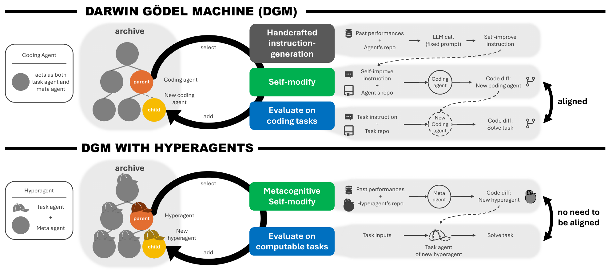
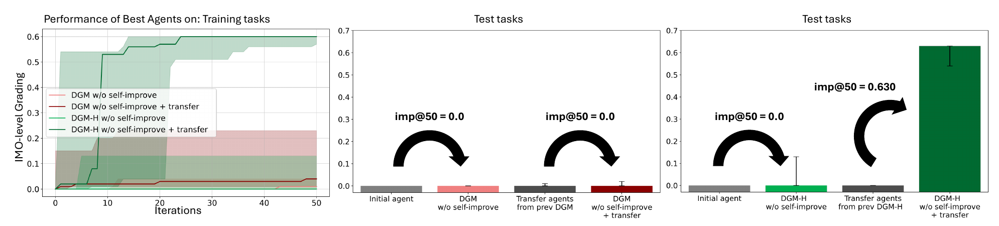
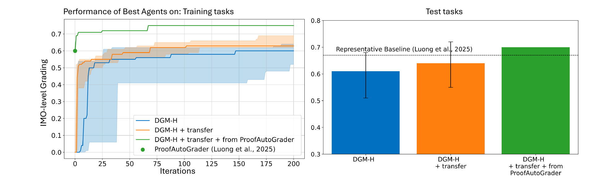

让 AI 写一段程序，把报错发回去，再让它修改，这已经是很常见的用法。如果它终于写对了，我们可以说这次回答变好了。但下次换一道题，它还会不会犯同样的错误？

一个自然的办法是让它记笔记：记住哪些尝试失败了，把有用的代码存成技能，下次遇到类似问题时拿出来用。这样，进步就有可能保留下来。

再往下想一步：如果它一直记错重点呢？比如每次优化都只记下“参数调大后更快”，却从不检查这条经验在哪些条件下失效。我们可以替它修改总结经验的方法。不过，这样一来，真正改进学习方法的仍然是人。

Hyperagents 想做的是把这一步也交给系统：让它修改自己的任务程序，同时修改产生这些改动的方法。

> **阅读重点：** 怎样测量“更会改进了”。

## 一、研究背景：从一次修改，到能够积累的进步

### 0. 这项工作从哪里来

论文署名来自不列颠哥伦比亚大学、Vector Institute、爱丁堡大学、纽约大学，以及 Meta FAIR 和 Meta Superintelligence Labs；首页注明 Jenny Zhang、Bingchen Zhao 和 Wannan Yang 的工作完成于 Meta 实习期间。这些信息有助于理解它为什么紧接着 DGM 讨论同一个问题：作者团队把前作中仍由人手写的改进流程，进一步变成了可修改对象。本文按 2026 年 3 月的 arXiv 预印本阅读；**ICLR 2026 接收的是前作 DGM，不是这里讨论的 Hyperagents**。

### 1. 基本概念：模型与 Agent 程序

先把“大模型”和“使用大模型的程序”分开。

模型负责根据输入生成输出。围绕它，我们还会写一层程序，决定读取哪些资料、调用什么工具、怎样处理报错、什么时候再问一次模型。这一层常被称为 agent 的工作流程。即使模型参数不变，流程不同，结果也可能差很多。

以写代码为例，直接让模型输出答案，和允许它查看文件、运行测试、根据报错修改，是两种不同的解题条件。后者不需要先训练一个新模型，就能利用测试反馈修正错误。

但反馈能影响多久，取决于系统把它存在哪里。只把报错留在本次对话中，下一次任务可能又要从头来过；把经验存到可检索的记忆里，才有机会在以后的任务中继续使用。

### 2. 过往：用反思和技能库保留经验

[Reflexion（2023）](https://arxiv.org/abs/2303.11366) 就探索了这种做法：让 agent 根据任务反馈写出文字反思，保存在记忆中，为后续尝试提供帮助。它改变的是可供模型读取的经验，而不是模型权重。

[Voyager（2023）](https://arxiv.org/abs/2305.16291) 在 Minecraft 中采用了另一种积累方式：把学到的行为保存成可执行的技能，之后再调用和组合。对技能库项目来说，这很容易理解——既然已经写过一段有用的程序，就没有必要每次都重新生成。

这两项工作解决的问题并不相同。把它们放在这里，是为了看清一点：一个 agent 的进步可以保存在文字记忆、技能代码和工作流程中，不一定发生在模型参数里。

### 3. 问题：经验越来越多，学习方法却可能一直没变

假设我们写了一个 kernel 优化助手。它每次做完实验，都按下面的规则更新技能库：

> 找到最快的配置，把配置和输入形状存下来；下次先试最相近的记录。

随着实验增加，技能库会越来越大，也可能越来越有用。但“记录最快配置、检索相近记录”这套规则仍然是我们写的。

如果它经常把偶然的计时波动当成真实收益，增加记录未必能解决问题。我们也许需要改成：重复测量，记录不确定性，再判断是否保存。又或者，形状相近并不代表瓶颈相同，需要改变检索依据。

这里有两个不同的修改对象：一个是库里的经验，另一个是决定怎样收集和使用经验的程序。研究“自我改进”时，如果不说清修改的是哪一个，很容易把它们混在一起。

RSI 是 Recursive Self-Improvement，通常译为递归自我改进。不同论文的定义并不完全一致。这篇论文关注的递归关系是：系统产生的新版本，还会参与下一轮自修改；其中，负责产生修改的机制也可以变化。至于变化之后是否更有效，要另外做实验，不能从“代码能改自己”直接推出来。

### 4. 前序工作 DGM：让编程 agent 修改自己的程序

[Darwin Gödel Machine，DGM（2025）](https://arxiv.org/abs/2505.22954) 是 Hyperagents 的直接前作。它让编程 agent 查看并修改自己的实现，再通过编程任务评估新版本。

这样做有一个很有用的条件：解编程题需要写代码，改进编程助手也需要写代码。两件事用到的能力存在重叠。比如，一个版本改善了代码编辑工具，这个工具既可能帮助它处理用户仓库，也可能帮助它下一次修改自身。

名字中的 Gödel 来自更早的自修改系统设想：先证明改动有益，再执行改动。但复杂程序的收益通常很难事先证明。DGM 采用实验检验，并借鉴演化搜索维护多个候选，而不是等待一份形式化证明。

这里的“证明”不是多跑几组测试。传统 [Gödel Machine](https://arxiv.org/abs/cs/0309048) 设想把目标写成形式化效用函数，由证明搜索器在执行自修改前，证明修改符合预设的收益条件。测试只能说明“在这些样本和环境里，改后表现如何”，不能证明所有未来情形都更好。困难也不宜简单归结为哥德尔不完备定理：现实任务的环境、成本、随机性和目标本身很难完整形式化。DGM 放弃事先证明净收益，改用有限任务上的经验评价；代价是实验结论也只在对应任务和预算下成立。

#### DGM 怎样把“自进化”变成实验？

DGM 从一个使用冻结基础模型、带命令执行与文件编辑工具的编程 agent 开始。外层循环反复选择父代、读取评估日志、提出改动、修改自身代码、测试子代并更新 archive。论文运行 80 轮，逐轮生成新 agent；每个子代先用少量任务检查能否继续编辑代码，再按条件扩大评估。**archived agent 不等于技能条目**：它是一个候选程序版本，关联得分、亲子关系和评估记录；低分但能继续修改的版本也可能成为后续“踏脚石”。

父代不是永远选当前最高分。原论文 §3 和 Appendix C.2 说明：抽样大致偏向高分、子代较少的节点；能通过编译并保留代码编辑能力的子代才进入 archive。这里的树是版本谱系和分支搜索逻辑，**不是论文指定的 `archive.json` 文件格式**。由人固定的仍有父代选择、评估协议以及生成改进指令的部分；所以 archive 是 DGM 的核心设计之一，却不等于它已学会编辑整个搜索算法。

量化时，DGM 看编程任务的解决比例，而不是直接测“未来更会改进”的独立指标。原论文报告 SWE-bench Verified 从 20.0% 到 50.0%；Polyglot **50 题搜索子集**从 14.0% 到 38.0%，再把选出的版本放到**完整 Polyglot**上，得到 14.2% 到 30.7%。这两组 Polyglot 数字不能拼成同一次评估。移除自修改后，SWE-bench / Polyglot 子集分别为 39.0% / 28.0%；移除 archive、沿单一路线继续，则为 23.0% / 14.0%（原文 Table 1）。这些消融支持“在该实验中，自修改和分支探索都重要”，但并不能单独证明改进器的能力已经跨任务增长——这正是 Hyperagents 后来引入 `imp@k` 的原因。

不过，DGM 还有人工固定的部分，包括分析评估结果、生成改进指令的机制。而且，任务能力与自修改能力的重叠，在换领域后未必成立。一个更擅长给数学解答评分的 agent，不一定也更擅长修改评分程序。

Hyperagents 从这里继续往前走：既然不能指望“任务做得好”自然带来“程序改得好”，就把这两种职责明确分开，并允许系统修改后者。

## 二、Motivation：用一个例子看清它要改什么

继续用 kernel 优化作例子。下面是为了帮助理解而设想的过程，不是论文或 AProf 已完成的实验。

执行优化的程序读取技能、生成代码、编译并计时。另一个程序读取这些实验记录，决定哪些经验值得写进技能库。我们暂且把后一个程序叫作“改进器”。

### 例子：一条错误的优化经验是怎样被保留下来的

- **原来的做法：** 改进器只保留最快的一次测量，把对应配置写成技能。
- **出现的问题：** 执行程序把技能用到新任务上，性能反而下降。回看记录，原来的快可能只是一次计时波动。
- **只修改技能：** 删除这条记录，或者换一个配置。下次更新技能时，仍可能因为相同原因记错。
- **修改改进器：** 把经验筛选改为先重复测量，再决定是否保存。以后产生的新技能都要经过这一步。

这个过程里，技能变了，产生技能的规则也变了。后一个变化才是我们要单独观察的东西。即便规则听起来合理，也还需要问：它有没有在同样预算下带来更多有效改进？会不会只是花了更多设备时间？

### 论文的做法：把改进器也作为修改对象

回到论文，执行任务的部分叫 **task agent**，负责修改程序的部分叫 **meta agent**。两者组成一个 hyperagent：

$$
H=(A,M)
$$

$A$ 是任务程序，$M$ 是改进器。它们可以调用相同或不同的基础模型；这里按职责区分，而不是按模型大小区分。

## 三、Method：一轮自修改是怎样发生的

论文把 hyperagent 放进 DGM 的搜索流程，得到 DGM-H。先看原文的总览图。上半部分是 DGM，下半部分是 DGM-H。



*原论文 Figure 1。DGM-H 把 task agent 和 meta agent 放进同一个可修改程序；蓝色部分仍负责用外部任务评价新版本。来源：Hyperagents v1，PDF 第 4 页，CC BY 4.0。*

读图时可以从下半部分橙色的 parent 开始。系统先从历史候选中选一个父代，再调用这个父代的 meta agent。它能看到程序实现、以前的评估结果和剩余预算，使用文件编辑等工具生成修改。

修改得到的新版本称为子代。子代可能换了解题提示，也可能增加了错误处理；如果改到了 meta agent，下次调用它时，产生修改的流程也会不同。

> meta agent 自己由谁修改？由当前版本的 meta agent。它编辑的是整个 hyperagent 的程序，因此也可以编辑负责自修改的那部分代码，不需要再额外安排一个永远固定的“上一级 agent”。不过，运行、选择和评价它的外层程序仍然存在。

用版本号写出来会更清楚：

```text
H₀ = (A₀, M₀)
  └─ 由 M₀ 修改程序，产生 H₁ = (A₁, M₁)
       └─ 如果 H₁ 被选作父代，由 M₁ 产生后续修改
```

这不是要求每一轮都同时改动两个部分。比如第一轮完全可能只修好任务程序中的解析错误，让 $A_1$ 发生变化，而 $M_1$ 仍与 $M_0$ 相同。

接下来，系统运行子代的 task agent，获得任务分数，并把符合要求的候选放回档案。这个档案叫 archive。后续不一定从最高分版本继续，也可能选择一个目前不占优势的版本探索。

为什么保留这些版本？因为一次改动可能先引入了有用的工具，却还没把工具用好。如果只允许当前最好版本留下，就可能过早丢掉这条路线。论文中的“open-ended exploration”在这里体现为对多条演化路线的保留；它并不意味着实验已经观察到了无止境的进步。

还要留意蓝色评价模块的位置。在主实验里，父代选择和评价协议仍在外层，由研究者固定。系统可以改自己的工作流程，但不能靠修改正确答案或评分标准让成绩上涨。

这里没有训练基础模型的新权重。被修改的是围绕模型运行的程序、提示、记忆和工具流程。论文后来使用 RL 训练机器人，是为了检验生成的奖励函数好不好，那是另一层实验。

### 它具体写出了哪些“改进基础设施”？

这些不是作者预先配置的四个标准模块，而是论文 §5.2 和 Appendix E.3 **从演化版本中抽出的定性代码案例**。它们展示了程序确实能改到“如何组织下一轮改进”，但案例本身不等于证明每项机制独立带来多少收益。

- **性能追踪：** 论文展示的 `PerformanceTracker` 把代号、领域、得分、时间和附加信息写入 `./outputs/performance_history.json`，`record_generation` 负责追加记录，`get_improvement_trend` 用最近两个窗口的平均分之差看趋势。它让后续修改能引用多轮结果，而不是只盯一次成功或失败。这是论文中的一个演化代码片段，不应误以为所有运行都预装同一个类。
- **跨代际记忆：** 另一个演化版本添加了 `MemoryTool`，把带时间戳的键值洞察写进 `./memory.json`，并可在后续调用中检索。保存的不只是分数，还包括“哪一代太严、哪一代更平衡、下一步尝试怎样组合”等假说。它与 archive 不同：archive 保存候选程序及谱系；记忆保存供修改器阅读的经验。论文展示了内容和调用方式，未单独量化这项记忆的因果贡献。
- **偏差检测：** 在审稿分类任务中，程序统计预测标签比例；附录示例在单一标签占比超过 80% 时把警告写进 meta agent 的指令，让它下一轮考虑修正。第 66 代的记忆记录提到 **94% 接受率、52% 准确率**；附录另举一例是 **99% 接受率、49% 准确率**，修正后到 **63% 准确率**。这是两处不同记录，不能说“94% 那次从 52% 直接升到 63%”。标签分布过于单一是诊断信号，并不自动等于分类器一定错；最终仍要看独立评估。
- **计算感知规划：** 代码根据 `iterations_left` 在“剩余多于 5 次”“3–5 次”和“至多 2 次”时给 meta agent 不同的修改建议：早期可尝试架构变化，后期更重视修错与保守改动。它只是按剩余迭代数调整**提示策略**，不是已证明最优的算力调度器，更不代表自动测量了每次模型调用或设备时间。

从工程角度看，前两项主要是持久化数据与读取接口，后两项是评估摘要和条件化提示。它们都写在 agent 能修改的程序一侧；外层评分和测试集并未因此变成可编辑。

## 四、Evaluation：怎样知道改进器真的变好了

### 先把“题做得更好”和“更会改题”分开

假设一个程序原来能答对 40% 的题，经过 50 次修改后达到 60%。这个结果说明搜索找到了更好的程序，却还不能说明改进器在这 50 次修改中变强了。一个始终不变的改进器，多试几次也可能找到好方案。

要判断改进器的能力，比较对象应该换一下：拿出旧、新两个改进器，分别让它们从同样的任务程序出发，给同样的修改机会，看谁能把程序改得更好。

论文为此使用 **improvement@k**，简称 `imp@k`。它表示一个固定改进器在最多 $k$ 次修改机会内，带来的任务分数增益。

先用一组虚构数字算一遍。两个改进器都从准确率 0.40 的程序开始，各修改 50 次。旧改进器最终选出的版本得分 0.52，新改进器选出的版本得分 0.61，那么：

$$
\operatorname{imp@50}_{\mathrm{old}}=0.52-0.40=0.12
$$

$$
\operatorname{imp@50}_{\mathrm{new}}=0.61-0.40=0.21
$$

新改进器在这次比较中带来的增益更大。0.21 表示准确率增加了 21 个百分点，不表示 50 次修改里有 21% 成功，也不是相对初始准确率提高 21%。

### “最终选出的版本”由谁选？

不能把所有版本放到测试集上测一遍，再拿最高分的那个。这样一来，测试集也参与了搜索。

论文 §5.2 的做法是按验证集成绩选版本，再报告测试集上的增益。可以把验证集理解成挑选方案用的练习题，测试集则留到方案确定后再做。把这两个用途写进公式，就是：

$$
A^*=\underset{A'\in\mathcal{A}^{(k)}}{\arg\max}\ Q_{\mathrm{val}}(A'),
\qquad
\operatorname{imp@}k=Q_{\mathrm{test}}(A^*)-Q_{\mathrm{test}}(A_0).
$$

$A_0$ 是初始程序，$\mathcal{A}^{(k)}$ 是修改得到的候选，$Q$ 是任务分数。前半句负责“选哪个”，后半句负责“报告提高多少”。这是按照正文评估流程展开的写法；附录 D.3 的原公式用统一的 Evaluate 记号表达最大增益，没有在公式里显式分开两个数据集。

计算过程中，接受测量的 meta agent 保持固定。乍看有点反常：研究自我改进，为什么又不让它改自己？因为现在要测的是某个已经得到的版本。如果它一边接受测量，一边又变成其他版本，就很难把结果归到它身上。

因此，实验先在源任务上演化出改进器，再冻结它测量。冻结测量与先前发生过自修改，并不矛盾。

### 论文把它放到什么任务上测？

作者先在论文评审和机器人奖励设计上运行演化。前者根据论文文本预测 accept/reject，成绩是与实际录用决定一致的准确率；后者生成奖励函数，再通过模拟器中训练出的机器人表现来评价。训练时机器人要向前走，测试时要提高躯干高度，跳跃因而成为有用的行为。

随后，作者把演化后的系统迁移到此前保留的奥数解答评分领域。任务输入包含题目、候选解答、参考解答和评分指南，输出是 0、1、6、7 中的分数，按与专家标签一致的准确率评价。

这不是让评审 agent 直接“零样本变成数学专家”。到了新领域以后，它仍然可以根据新领域的训练反馈修改程序，用验证集选择版本，最后在独立测试集上报告结果。研究者想知道的是：此前形成的改进方法，能不能帮助这段新学习过程。

下面这组实验固定 meta agent，给每组 50 次修改机会。



*原论文 Figure 3。左图横轴是修改次数，纵轴是训练任务上的评分准确率；中、右图比较起始程序和选中版本的测试成绩。右侧深绿色柱子对应迁移后的 DGM-H。来源：Hyperagents v1，PDF 第 10 页。*

> 图例里的 `w/o self-improve` 容易误读。这里不是禁止修改任务程序，而是测量期间不再更新 meta agent。`+ transfer` 表示从先前源领域的实验中带入一个已经演化过的版本。训练曲线和测试柱图也要分开看，不能用左图的最高点代替最终测试成绩。

初始 DGM-H 改进器的 `imp@50` 中位数是 0.0，95% 置信区间为 0.0–0.130；迁移 DGM-H 的中位数是 **0.630**，区间为 **0.540–0.630**。从人工适配过的 DGM-custom 迁移，则仍为 0.0，区间为 0.0–0.010。

这些数字来自 5 次独立运行。图中的 50 轮是每次运行内部的修改次数，不能当成 50 个独立样本。误差条来自论文的 bootstrap 估计，提醒我们不同运行的结果也会变化。

这是论文最值得关注的结果：在新的领域里，源领域演化得到的系统仍能产生有用的修改。

但它还不是刚才那个完全控制起点的例子。作者实际迁移了整个 hyperagent，task agent 和 meta agent 都一起带过去；不同组在新领域的起始成绩虽然都接近零，起始程序却不完全相同。因此，如果希望更严格地判断收益是否来自改进器，可以补一个实验：保持任务程序一致，只交换 meta agent。这是对实验的进一步建议，不是论文已经做过的同起点对照。

## 五、任务进步之后，还能继续改进吗？

### 1. 对照实验：去掉自修改或候选档案会怎样

在看后续递归之前，先确认系统确实能把任务做好。评审与机器人实验运行 100 轮后，DGM-H 的测试结果分别是：评审准确率 0.710，机器人任务分数 0.372。前者的 95% 区间为 0.590–0.750，后者为 0.355–0.436。

这两个数不能直接互相比大小：一个是分类准确率，一个是机器人任务分数。机器人实验还需要训练控制策略，评估成本也不与评审相同。

如果固定初始 meta agent，只让它修改 task agent，两个领域的中位数分别降到 0.0 和 0.213；如果去掉候选档案、只沿一条路线修改，则分别为 0.0 和 0.116。论文报告完整 DGM-H 相对这两项消融的差异显著。这说明，在这些设置里，让改进器参与演化、保留不同候选，确实对结果有帮助。

另一个重要对照是 DGM-custom：研究者人工将 DGM 的指令生成机制适配到新领域。它在两个任务上的中位数分别为 0.590 和 0.348。DGM-H 虽然更高，但差异不显著。因而不能仅凭这组结果说自动演化已经可靠地胜过人工定制。

### 2. 解除冻结，让迁移后的系统继续修改自己

上一节的 `imp@50` 是对固定改进器的测量。论文 §5.3 又做了一组不同的实验：让迁移后的 hyperagent 在数学评分任务上继续自修改，运行 200 轮。



*原论文 Figure 4。左图是训练曲线，右图是测试结果。蓝色从初始系统开始，橙色使用迁移系统，绿色以 ProofAutoGrader 作为任务程序并使用迁移改进器。来源：Hyperagents v1，PDF 第 13 页。*

看右图的蓝、橙两根柱子：测试准确率的中位数分别是 0.610 和 0.640，95% 区间分别为 0.510–0.680、0.550–0.720。迁移版本略高，但论文报告差异不显著。仅凭这组结果，还不能确定过去的演化让后续改进稳定地加快了。

绿色柱子回答了另一个问题：如果任务程序一开始就不错，还能不能继续改？作者将已有的数学评分程序 ProofAutoGrader 与迁移改进器组合，测试子集上的准确率从 0.670 提高到 0.700。之后在完整 IMO-GradingBench 上评估，准确率从 0.561 提高到 0.601。

子集与完整集合是两个统计范围，所以这里有两对数字。后一个实验至少说明，自修改并不只能用于一个很差的起点。但“能接着改进”和“以后会越来越快地改进”仍需要不同的证据。本文的有限轮数实验还没有回答后者。

## 六、局限：哪些因素会影响我们对结果的判断

第一个因素是起点。论文的初始评审程序缺少任务要求的输出格式和解析处理，因此得分为零，初始数学评分程序也有类似问题。修复格式当然有用，却与学到更好的评审或数学推理方法不是一回事。读到从 0 提升到很高的数字时，需要先看初始程序到底为什么失败。

第二个因素是预算。`imp@50` 对齐了修改次数，没有自动对齐费用。一次修改可以调用一次模型，也可以调用十次；可以运行很便宜的文本判断，也可以启动一轮机器人训练。要研究改进效率，还应记录模型消耗、执行时间和失败重试。迁移之前用于获得改进器的搜索成本，也不能在总成本分析中消失。

第三个因素是我们实际测到了什么。论文评审的标签是历史录用决定，不是一个无争议的“论文质量真值”。同样，测试集上的提升说明系统适应了这些任务，不代表它已经具有任何领域都适用的自我改进能力。

最后，自修改的范围仍有限。主实验固定任务分布、外层选择和评价规则，基础模型权重也没有变化。论文提供的是一个能够研究自修改的系统与几组积极结果，而不是无限递归增长的证明。

## 七、个人思考：回到 AProf，先测哪件事？

下面是从论文延伸出的研究想法，尚不是 AProf 的实验结论。

开头那个优化助手，其实可以产生三种不同的进步：当前 kernel 变快；技能库使下一批任务做得更好；负责编辑技能库的程序更容易产生有用经验。它们都值得研究，但需要分别测量。

如果关心第三种，就可以借用本文的诊断办法。拿同一个初始技能库，固定执行模型和工具权限，让旧、新改进器各自编辑。开发任务用来提供反馈和选择最终库，未参与编辑的新任务用来报告收益。这样比较的就不是“谁以前积累得多”，而是“从同样条件出发，谁更会改”。

硬件任务的好处是可以测正确性和真实耗时，困难是每条反馈都要付出编译、运行和测量的成本。一个改进器即使成功率更高，如果多用了数倍设备时间，也未必更适合实际工作。这里最好先分别报告效果与成本，不急着揉成一个总分。

至于华为与 Tenstorrent 之间的迁移，可以先问一个更小的问题：在一种硬件上形成的实验组织方式，到了另一种硬件上是否仍然有用？比如先验证瓶颈、再选择候选、保留反例。这些方法有可能迁移；某个具体 tile 参数则很可能依赖架构。要迁移什么，应当在实验之前说清楚。

读完这篇论文，我会先留下这样一个判断标准：一个改进器的价值，要看它以后能产生什么改进，而不只看它自己或它携带的任务程序现在得了多少分。

## 读完后，试着换一个条件

回到前面的虚构例子：新改进器带来 0.21 的增益，旧改进器只有 0.12。现在补充一个条件——新改进器每轮调用十次模型，旧改进器每轮只调用一次。我们还能说新改进器“效率更高”吗？

这里能保留的结论是：在相同修改次数下，新改进器取得了更大的收益。若要比较效率，就需要另外对齐或报告模型用量，最好画出收益随实际预算变化的曲线。把“固定什么、改变什么”说清楚，就能把一个很大的 RSI 问题变成具体实验。

也可以试着不用 task agent、meta agent 这些词，用自己的项目解释一次：现在谁在执行任务，谁在提出修改，下一轮有没有真的用上自动修改后的方法？这几个对象找清楚后，再去读论文的实现会容易得多。

## 原文与延伸阅读

这份笔记依据 [Hyperagents，arXiv:2603.19461v1](https://arxiv.org/abs/2603.19461v1)，按预印本记录；使用的 60 页 PDF 首页标注 March 23, 2026。实验数字均来自原文，未独立复现。方法见 §3，任务实验见 §5.1，`imp@k` 见 §5.2 与 Appendix D.3，继续自修改见 §5.3。

- [Hyperagents 原文 PDF](https://arxiv.org/pdf/2603.19461v1) 与[官方代码](https://github.com/facebookresearch/HyperAgents)。
- [Reflexion](https://arxiv.org/abs/2303.11366)：反馈怎样变成后续尝试可以使用的文字经验。
- [Voyager](https://arxiv.org/abs/2305.16291)：怎样把已经获得的行为保存为可复用技能。
- [Darwin Gödel Machine](https://arxiv.org/abs/2505.22954)：Hyperagents 的直接前作，理解候选档案与程序自修改时可回看。
- [Lilian Weng：LLM Powered Autonomous Agents](https://lilianweng.github.io/posts/2023-06-23-agent/)：如果对 agent 的规划、记忆和工具还不熟悉，可用来补背景。

三张图均从 Hyperagents 原 PDF 裁取，保留原始图号和内容，作者为 Jenny Zhang 等人，遵循 [CC BY 4.0](https://creativecommons.org/licenses/by/4.0/)。
