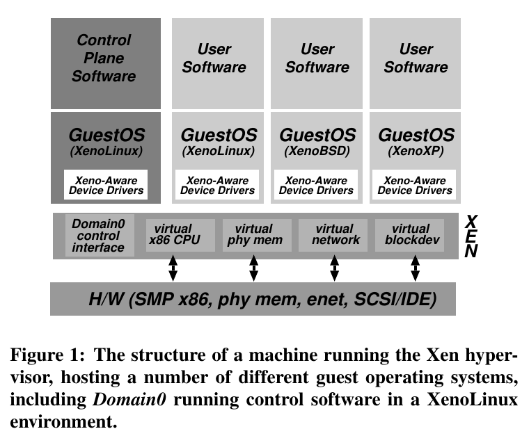
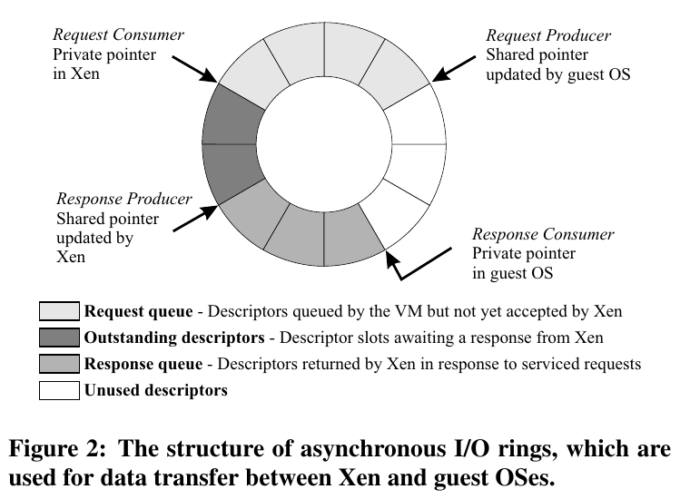
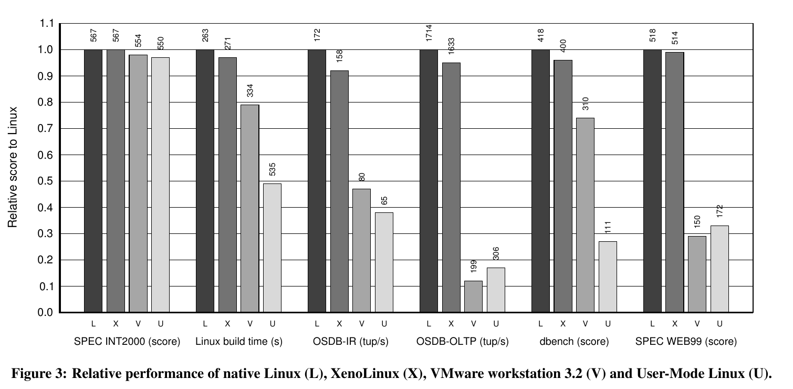

> **一句话总结：** Xen 不要求把硬件的每个细节原样模拟给操作系统，而是修改 guest 内核与虚拟机接口、保持应用 ABI 不变，以换取更低的虚拟化开销与可管理的资源隔离。

## 一、Short summary：四个问题的简答

以下英文短总结约 220 词，按常规正文排版可放在一页以内；后文给出中文机制与实验解析。

**What kind of paper is this?** This is a systems paper presenting the design, implementation, and empirical evaluation of Xen, an x86 virtual machine monitor.

**Motivation.** Xen aims to let multiple operating systems share commodity servers with useful isolation and low overhead. Contemporary x86 hardware made transparent virtualization difficult: some sensitive instructions did not trap appropriately, while virtualizing memory management introduced substantial complexity. Sharing one conventional OS also offered limited separation between independently managed services.

**Benefits over prior approaches.** Xen uses paravirtualization: guest kernels cooperate through a revised machine interface, while existing application binaries remain unchanged. Validated, batched page-table updates and asynchronous descriptor rings reduce overhead. Domain0 hosts management policy outside the hypervisor. In the reported experiments, Linux kernel compilation took 271 seconds on Xen versus 263 seconds natively, and SPEC WEB99 scored 514 versus 518. Xen also substantially outperformed VMware Workstation 3.2 and User-mode Linux on several system-intensive workloads.

**Drawbacks and potential problems.** Guest kernels require modification and maintenance. The measured guest was XenoLinux; the Windows XP port remained incomplete. Near-native application performance did not eliminate higher page-fault and process-creation costs. Disk-intensive workloads did not consistently receive throughput proportional to assigned weights. Isolation tests covered selected disruptive workloads rather than proving universal protection. Quantitative ESX Server comparisons were unavailable because of licensing restrictions, so claims about superiority must stay within the published evidence.

## 二、论文概览与 Motivation

原题 **Xen and the Art of Virtualization**，发表于 SOSP 2003。本文采用本地 14 页版本，并核对剑桥大学保存的论文链接。讨论对象是当时的 Xen 原型，而非现代 Xen 的全部实现。

论文希望在普通服务器上同时运行多个可以独立配置的 OS 实例，支持服务器整合与托管服务。目标同时包括：应用兼容、低开销、资源隔离和资源管理。

当时的 x86 对全虚拟化并不友好：部分需要特殊处理的指令在低特权级下不会按 VMM 所需方式触发陷入；页表也由硬件遍历，不能简单假装每个 guest 都独占机器。传统全虚拟化可以用二进制翻译与影子页表应对，但要付出额外维护与执行成本。

**论文的核心观察：应用程序需要稳定 ABI，不必要求 guest 内核看到一台完全不变的真实机器。** 因此 Xen 修改内核接口，但保留用户程序所依赖的二进制接口。这与容器共享同一宿主内核的做法不同。

## 三、Method：哪些地方合作，哪些地方仍须隔离

### 1. 总体结构与 Domain0

*图 1：Xen 的系统结构。底部是硬件，中间是提供 CPU、内存、网络与块设备抽象的 Xen，上方是各个 guest；Domain0 承载管理软件。来源：原论文 Figure 1，PDF 第 5 页，直接裁取原图。*

读图时应区分数据路径与管理策略。Xen 执行页表检查、CPU 调度和 I/O 访问控制；Domain0 通过受授权的接口创建／销毁 domain、配置资源和网络规则。复杂管理策略可以放在 guest 中，而不全部塞进最高特权的 hypervisor。

图中 XenoBSD、XenoXP 表示目标架构，不代表论文已经完成这些系统的全面测试。正文明确：XP 移植尚缺虚拟 I/O 驱动，评估主要使用 XenoLinux。

### 2. CPU：guest 内核也要受约束

在论文的 x86 原型中，Xen 位于 ring 0，guest 内核移到 ring 1，应用仍在 ring 3。guest 通过 **hypercall** 请求需要最高权限的操作；Xen 用 **event** 向 guest 异步通知 I/O 完成等事件。

并不是每次应用系统调用都必须先进入 Xen。guest 可以注册经过校验的快速系统调用入口；但缺页还需要 Xen 读取只能在 ring 0 访问的 CR2，再向 guest 传递故障地址。这解释了为什么系统调用开销可以很低，缺页开销仍然明显。

这里的 ring 分配是 2003 年原型的具体设计，不是所有虚拟化架构都必须采用的固定方案。

### 3. 内存：guest 管理页表，Xen 验证更新

guest 从自己的内存配额中分配页表并注册给 Xen。注册后不再拥有任意直接写页表的权限，更新需通过 hypercall 校验；例如不能映射不属于自己的页，不能把页表同时当作普通可写数据。

Xen 使用页框类型与引用计数维持这些约束，guest 可批量提交更新以摊薄 hypercall 成本。**批处理也有正确性边界**：新映射使用前必须提交；若 guest 省略了原本会触发提交的 TLB flush，缺页处理还需检查是否有未提交更新。

guest 看到的连续“物理内存”可以由不连续的 machine pages 组成，转换关系由 guest 与 Xen 共同维护。这不是后来硬件嵌套页表的实现。

### 4. I/O：描述符环与通知分离

*图 2：异步 I/O 描述符环。guest 与 Xen 各有请求／响应生产者和消费者位置；颜色表示请求、等待响应、响应与未使用的描述符。来源：原论文 Figure 2，PDF 第 6 页。*

环中保存的是**描述符，不是完整数据本体**；数据缓冲区由 guest 另行分配，Xen 校验并在传输期间保护相应页框。guest 提交请求，Xen 处理并返回带同一标识的响应，允许根据调度需求重排 I/O。

请求入队和通知对方是两件事：多个请求可以一起通知，一批响应也可以达到阈值再触发事件。因此可以在吞吐量和延迟之间取舍，而不是每个请求都支付一次完整通知成本。

### 5. 资源管理如何服务隔离

各 domain 有自己的内存配额与分页责任，避免由 VMM 为所有 guest 无差别换页造成相互拖累。CPU 使用 BVT 调度，支持事件到来后的低延迟唤醒；Domain0 可以调整配额和参数。

**机制提供隔离的基础，具体资源分配策略仍需实验检验。** 尤其磁盘吞吐量不只由权重决定，还受访问模式与调度影响。

## 四、Evaluation：接近原生，具体是哪些测试

### 1. 实验条件与比较对象

论文 §4 使用双处理器 2.4 GHz Xeon、2 GB RAM、千兆以太网和单块 SCSI 磁盘；guest 基于 Linux 2.4.21。相对性能测试 §4.1 将机器配置为单 CPU，结果取 **7 次试验的中位数**；后面的多 domain 实验使用双 CPU，不应混为同一协议。

公开比较对象是原生 Linux、XenoLinux、VMware Workstation 3.2 和 User-mode Linux（skas3）。作者说明 ESX Server 受许可限制不能发布量化结果，所以正文对 ESX 的定性说法不能替代公开数据。

### 2. 应用层性能：先分清分数与耗时

*图 3：各项性能相对原生 Linux 归一化，L／X／V／U 分别表示原生、Xen、VMware Workstation 3.2、UML；柱顶保留原始数值。来源：原论文 Figure 3，PDF 第 9 页。*

纵轴越高表示归一化性能越好。Linux build 是时间指标，越短越好，其归一化方向与原始秒数相反，不能把 271 秒大于 263 秒解释为 Xen 更快。

- **内核构建**：原生 263 秒、Xen 271 秒，耗时增加约 **3.0%**；这是按原图计算的比值，不是所有任务的统一开销。
- **SPEC WEB99**：原生 518、Xen 514，分数下降约 **0.8%**。它衡量满足基准 QoS 条件的负载能力，不是单次网页响应时间。
- **OSDB-IR**：172 对 158 tuples/s，吞吐下降约 **8.1%**；**OSDB-OLTP**：1714 对 1633 tuples/s，下降约 **4.7%**。即便图中多数柱接近 1，也不能把所有应用概括成“只有 1% 开销”。

上述均是论文测量值或据其测量值换算，本笔记没有独立复现。

### 3. 微基准与隔离：不能只看最好看的图

Table 3 中，`fork` 为原生 L-UP **110 μs**、Xen **198 μs**；Table 5 中，page fault 为 L-UP **1.42 μs**、Xen **2.73 μs**。页表更新验证与保护域切换提供了机制解释：应用整体接近原生，不意味着每项内核操作都接近原生。

§4.4 的四 domain 实验中，两者运行正常数据库／Web 负载，另外两者产生磁盘密集小文件操作、fork bomb 与虚拟内存压力。论文报告正常负载相较此前结果分别下降 **4% 和 2%**。这支持所测干扰下的隔离效果，不能提升为对任意恶意负载的普遍保证。

§4.3 还报告，OSDB-OLTP 的磁盘同步活动使高权重 domain 没有获得成比例的吞吐提升，暴露了磁盘调度的局限。这属于论文自身给出的反例，不应在总结“资源可控”时省略。

## 五、局限与潜在问题

1. **移植与维护成本**：guest 内核需要配合修改，不能直接运行任意未修改内核；闭源系统尤其受可修改性与驱动支持限制。
2. **评估覆盖不完整**：Linux 结果不能代表 Windows XP／NetBSD；某些高开销操作在真实工作负载中的占比会改变总体表现。
3. **资源隔离仍有短板**：共享缓存和设备带来残余干扰，所测磁盘调度也未实现按权重成比例服务。
4. **控制面仍有信任边界**：个人分析：把策略移出 hypervisor 有助于缩小机制代码，但不能据此忽略高权限 Domain0 的故障与被攻陷风险；论文没有给出全系统安全证明。
5. **历史比较边界**：结论针对 2003 年的软件、硬件与基线，不能用这些数字宣称胜过现代硬件辅助虚拟化方案。

## 六、个人思考与课程关联

**个人理解：** Xen 最重要的设计选择是重新定义“必须兼容什么”。保持应用 ABI，把内核硬件接口改成可校验、可批处理的协议，形成了性能与移植代价的明确交换。

与 JOS Lab 2 对照，可以问：为什么内核能改用户页表，而运行在 Xen 上的 guest 内核自己也不能任意写所有映射？二者都是先确定谁拥有资源、谁能授权映射，只是 Xen 在 guest OS 之下又增加了一层保护边界。

与 [THE](/papers/the-multiprogramming-system/) 对照：THE 强调隐藏下层时序以方便推理；Xen 强调向 guest 暴露真实时间或机器地址有时有益。二者都表明，抽象需要服务具体目标，而不是越透明或隐藏越多就一定越好。

阅读中保留的问题：

- 如何在减少通知次数的同时避免把交互式请求拖慢？
- 如果批量页表更新尚未提交就使用映射，谁负责发现并恢复？
- 用什么额外负载检验磁盘、缓存和内存干扰，才能超出论文的单组隔离实验？

## 七、结论与参考链接

Xen 用修改 guest 内核换取一个更直接的虚拟化接口，并用应用基准、微基准与多 domain 测试说明这种交换在当时的配置下很有价值。阅读时应同时保留其兼容性目标、确切比较对象和未消失的开销。

- [SOSP 原论文与 DOI](https://doi.org/10.1145/945445.945462)
- [剑桥大学原论文 PDF](https://www.cl.cam.ac.uk/research/srg/netos/papers/2003-xensosp.pdf)
- [微软研究院论文记录](https://www.microsoft.com/en-us/research/publication/xen-and-the-art-of-virtualization/)
- 本地作业摘要用作问题线索；数值按原文 Figure 3、Tables 3／5 与 §4.3–4.4 核对。英文短总结与中文扩展解析分开，整篇博客不受“一页短总结”的篇幅限制。
